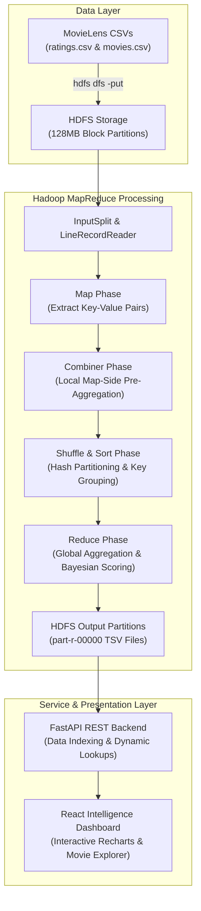

# CineMetrics: Movie Ratings Analysis Using Apache Hadoop MapReduce

[](https://www.oracle.com/java/)
[](https://hadoop.apache.org/)
[](https://fastapi.tiangolo.com/)
[](https://react.dev/)
[](https://tailwindcss.com/)

**CineMetrics** is an end-to-end Big Data Analytics project built for university examination and production-grade demonstration. It leverages **Apache Hadoop MapReduce** running on **HDFS** and **YARN** to process the GroupLens MovieLens dataset, exposing analytical results via a high-performance **FastAPI** backend and an interactive cinematic dark-themed **React** dashboard.

---

## Academic Context

- **Institution:** SRM Institute of Science and Technology, Ramapuram
- **Course:** Big Data Essentials (`21CSC314P`)
- **Degree:** B.Tech Information Technology
- **Student Developer:** Achyuth PV
- **Purpose:** College Project, Practical Lab Grading, and Viva Voce Examination

---

## 1. System Architecture



---

## 2. The 10 Core Analytical Questions Answered

All metrics displayed in CineMetrics originate from verified MapReduce batch jobs:

1. **Highest Average Rated Movies:** Identified via `AverageRatingJob` with Bayesian damping to prevent single-vote bias.
2. **Most Rated Movies:** Ranked via `MostRatedJob` (e.g. *Forrest Gump* with 329 reviews).
3. **Catalogue Mean & Variance:** Average rating and vote counts calculated for all 9,742 movies.
4. **Genre Popularity vs. Acclaim:** Map-side join in `GenrePopularityJob` proves *Drama* receives the most reviews (41,928), but *Film-Noir* achieves the highest mean rating (3.92 ★).
5. **Rating Spectrum Distribution:** Mode is 4.0 stars (26,818 ratings); half-star scores make up 14.8% of submissions.
6. **Decade Quality Perception:** `YearRatingJob` traces perceived film quality across release years from 1920 to 2020.
7. **Hidden Gems Discovery:** Bayesian weighted rating identifies 355 high-quality (≥ 4.0 ★) but overlooked films.
8. **Volume vs. Score Correlation:** Evaluates audience behavior across review counts.
9. **Multi-Label Genre Tokenization:** Handles pipe-separated multi-label categories seamlessly in the mapper.
10. **Review Submission Velocity:** `RatingTrendsJob` tracks monthly user review volume over two decades.

---

## 3. MapReduce Jobs Specification

| Job Name | Main Java Class | Input | Output Key $\to$ Value | Combiner Used? |
| :--- | :--- | :--- | :--- | :--- |
| **Job 1: Average Rating** | `AverageRatingJob.java` | `ratings.csv` | `movieId` $\to$ `(avgRating, count)` | **Yes** (partial sum & count) |
| **Job 2: Most Rated** | `MostRatedJob.java` | `ratings.csv` | `movieId` $\to$ `totalRatings` | **Yes** (count sum) |
| **Job 3: Distribution** | `RatingDistributionJob.java` | `ratings.csv` | `ratingValue` $\to$ `frequency` | **Yes** (frequency sum) |
| **Job 4: Genre Popularity** | `GenrePopularityJob.java` | `ratings.csv` + `movies.csv` | `genre` $\to$ `(movieCnt, ratingCnt, avg)` | **No** (Set uniqueness) |
| **Job 5: Year Ratings** | `YearRatingJob.java` | `ratings.csv` + `movies.csv` | `releaseYear` $\to$ `(ratingCnt, avg)` | **Yes** (partial sum & count) |
| **Job 6: Hidden Gems** | `HiddenGemsJob.java` | `ratings.csv` + `movies.csv` | `movieId` $\to$ `(avg, count, weightedScore)` | **Yes** (partial sum & count) |
| **Job 7: Rating Trends** | `RatingTrendsJob.java` | `ratings.csv` | `YYYY-MM` $\to$ `(count, avgRating)` | **Yes** (partial sum & count) |

---

## 4. Technology Stack

- **Big Data Processing:** Apache Hadoop 3.3.6 (HDFS, YARN, MapReduce API), Java 17 LTS, Apache Maven 3.9.6
- **Backend API:** Python 3.14 / 3.11+, FastAPI 0.115, Uvicorn, Pydantic v2
- **Frontend Dashboard:** React 19, TypeScript, Vite, Tailwind CSS v4, Recharts, Lucide React
- **Containerization:** Docker & Docker Compose (pseudo-distributed single-node Hadoop cluster)
- **Syllabus Extensions:** Apache Pig Latin (`.pig`), PySpark (`pyspark.sql`)

---

## 5. Quick Start Instructions (Local Windows / PowerShell)

### Prerequisites
- Java JDK 17 installed
- Node.js LTS (v20+ or v24+) installed
- Python 3.10+ installed

### Step 1: Clone and Enter Repository
```powershell
git clone https://github.com/achyuthpv/cinemetrics.git
cd cinemetrics
```

### Step 2: One-Click Master Startup
Run the automated startup script:
```powershell
.\scripts\run_all.ps1
```
*(Or double-click `scripts\run_all.bat` on Windows)*

This script automatically:
1. Validates MovieLens CSVs.
2. Executes the MapReduce processing pipeline.
3. Starts the FastAPI backend at `http://localhost:8000`.
4. Starts the React Dashboard at `http://localhost:5173`.

---

## 6. Hadoop Cluster Execution (Docker Mode)

To run all MapReduce jobs inside a genuine Apache Hadoop YARN cluster:

```bash
# 1. Start single-node Hadoop cluster (NameNode, DataNode, YARN ResourceManager)
docker-compose up -d hadoop

# 2. Check cluster health
curl -f http://localhost:9870  # HDFS NameNode Web UI
curl -f http://localhost:8088  # YARN ResourceManager Web UI

# 3. Enter container and execute the 7 MapReduce jobs
docker exec -it cinemetrics-hadoop bash /data/scripts/run_hadoop_jobs.sh

# 4. View output on HDFS
docker exec -it cinemetrics-hadoop hdfs dfs -ls /cinemetrics/output/
```

---

## 7. Compiling & Testing

### Compile MapReduce Java Code:
```powershell
cd hadoop
mvn clean package
```
*Generates the executable Uber-JAR: `hadoop/target/cinemetrics-mapreduce-1.0.0.jar`.*

### Run Java JUnit Tests (8 tests):
```powershell
cd hadoop
mvn test
```

### Run Backend PyTest Suite (14 tests):
```powershell
python -m pytest tests/test_backend_api.py -v
```

---

## 8. Dashboard Pages Overview

- **Page 1 — Overview:** 4 Primary KPIs (9,742 movies, 100,836 ratings, 610 users, 3.50 ★ global mean), global rating distribution histogram with percentages, exact Top 10 most rated movies, compact Hidden Gems preview, and dynamic insight cards.
- **Page 2 — Movie Explorer:** Searchable, filterable catalogue across all 9,742 titles with title search, multi-genre selection (AND / OR mode), release year bounds, table and grid view switch, side-by-side comparison (2 to 4 movies) with per-movie half-star distributions, and movie detail drawer with Viva Bayesian formula breakdown.
- **Page 3 — Genre Analytics:** Map-side join results comparing rating volume vs critical acclaim across 20 genres, multi-genre taxonomy educational callout, and one-click deep link to Explorer.
- **Page 4 — Rating Intelligence:** Temporal trends, decade quality charts, interactive Bayesian hidden gems engine with threshold controls, and arithmetic average pitfall explanation.
- **Page 5 — Hadoop Job Monitor:** Live HDFS/YARN connection indicators, engine provenance tracking, job execution metrics, and interactive Raw Partition Output Inspector to verify real TSV outputs.
- **Page 6 — Architecture & Viva Guide:** 8-stage pipeline deep dive, worked numerical example (5 ratings), Big Data 5 Vs, and 20 college viva Q&As.

---

## 9. 5-Minute Demonstration Guide for Viva

1. **0:00 - 1:00 (Introduction):** Introduce yourself (Achyuth PV, SRM Ramapuram, Big Data Essentials 21CSC314P). State the objective: analyzing 100k+ MovieLens ratings using Apache Hadoop MapReduce.
2. **1:00 - 2:00 (Hadoop Architecture):** Open `/architecture`. Explain the 8-stage pipeline: HDFS $\to$ Mapper $\to$ Shuffle & Sort $\to$ Reducer $\to$ Output. Walk through the worked numerical example.
3. **2:00 - 3:00 (MapReduce Jobs & Code):** Open `hadoop/src/main/java/com/cinemetrics/mapreduce/`. Highlight `AverageRatingJob.java` (in-mapper combiner) and `GenrePopularityJob.java` (DistributedCache map-side join).
4. **3:00 - 4:00 (Live Analytics Dashboard):** Open `http://localhost:5173`. Show the Overview mode, the Movie Explorer, and the Rating Intelligence trends.
5. **4:00 - 5:00 (Hadoop Monitor & Conclusion):** Open `/hadoop`. Explain cluster telemetry, partition outputs (`part-r-00000`), and answer examiner questions using the built-in Viva section.

---

## 10. Top 10 Viva Questions & Answers

1. **Q: Why use a Combiner for rating sums but not raw averages?**  
   *A: Average is non-associative: $\text{Avg}(\text{Avg}(A), \text{Avg}(B)) \ne \text{Avg}(A, B)$. The Combiner emits partial $(\text{sum}, \text{count})$ pairs so the Reducer computes the true mathematical average.*
2. **Q: How does a Map-Side Join work?**  
   *A: The smaller dataset (`movies.csv`) is cached in worker RAM via Hadoop's `DistributedCache`. The Mapper looks up movie genres in memory while streaming `ratings.csv`, avoiding costly network shuffles.*
3. **Q: What is Bayesian Weighted Rating?**  
   *A: $\text{WR} = \left(\frac{v}{v+m}\right) R + \left(\frac{m}{v+m}\right) C$. It damps movies with few votes towards the global mean $C=3.50$, ensuring movies with one 5-star rating don't unrealistically top the catalogue.*
4. **Q: What is Data Locality?**  
   *A: Hadoop schedules tasks on the physical machine where the HDFS data block resides (Rack/Node local), minimizing network switch saturation.*
5. **Q: What are the master and worker daemons in Hadoop?**  
   *A: Storage: NameNode (Master) & DataNodes (Workers). Compute: ResourceManager (Master) & NodeManagers (Workers).*

---

## License

This project is submitted for academic evaluation under the SRM Institute of Science and Technology curriculum. The MovieLens dataset is provided by GroupLens Research for education and research purposes.
